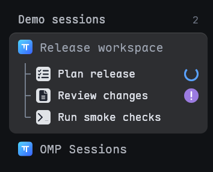

# OMP Sessions for Tern

See what OMP is doing in Tern’s sidebar, expand live split-pane titles, and jump to a specific pane with the keyboard. Search local OMP session history and resume a saved session in a new tab. The plugin runs inside Tern, with no web server or npm installation step.



*Captured in a separate Tern window with fictional sessions and simulated alerts. Only the session sidebar is shown; no real projects appear in the image.*

## Install

- Tested on Windows with Tern 0.9.13, OMP 18.18.2, and Node.js 24. Other platforms and versions have not been verified.
- Make sure `tern.com`, `node.exe`, and `omp.exe` are on the **Tern desktop process’s PATH**. Adding them only in a PowerShell startup script is not enough. Restart Tern and its session daemon after changing the system or user PATH. On Windows, resuming a saved session uses PowerShell 7 as the Tern shell.

With Git on PATH, install directly from GitHub:

```powershell
tern plugin install https://github.com/yizixu/tern-omp-sessions.git
tern plugin list
```

If you downloaded the source instead, run `tern plugin install .` from the directory containing `plugin.toml`.

The plugin ID is `omp-sessions`. Enable **vertical tabs** in Tern to see the sidebar changes. You can open the session panel with a shortcut or from the command palette.

## Use

| Action | Shortcut or command |
| --- | --- |
| Open the session panel | `Ctrl+Alt+O` or **Open OMP Sessions** |
| Find and jump to a pane | `Ctrl+Alt+J` or **Jump to Pane** |
| Open the selected session | Click the row or press `Enter` |
| Cycle **All**, **Open**, and **History** | `Tab` or `Shift+Tab` |
| Focus search | `Ctrl+L` or `/` |
| Clear search | `Esc` |
| Refresh | `F5` |

### Sidebar

- Tabs with multiple panes show every live pane. Pane and window focus changes keep the caption list in place without waiting for a refresh. Clicking the sidebar still switches the whole tab; use **Jump to Pane** to go directly to a split.
- OMP captions and **Jump to Pane** use saved conversation names instead of child-process terminal titles such as `node (vitest 3)`. Unnamed conversations use their first user message or session filename. A custom tab name is preserved; an unnamed OMP tab uses its focused conversation's name. Other terminals retain their native titles.
- Conversation names are checked about every two seconds and cached in memory. Process-title events on known OMP panes do not refresh the caption stylesheet; actual conversation-name changes still update normally. Tern's native hover tooltip may retain raw terminal details.
- Each tab keeps one native icon for its focused pane as the parent anchor, without duplicate back layers. Every child pane still has its own icon.
- Pane captions are 24 px tree rows with 16 px icon tiles, aligned titles, and their own status slots. Nerd Font title icons keep their original glyph; plain titles use a terminal, Git, browser, or file icon.
- The tree rail aligns with the parent icon's horizontal centre, with an 8 px gap below the parent title. Each branch leaves 6 px before the pane icon and 8 px between the icon and title. The tree stops at the final row.
- Each split pane has its own fixed status slot beside its caption. The tab title no longer combines different panes' states. A single-pane tab keeps its status beside the main title. Idle panes leave their slot empty, without moving any text.
- A blue ring means **Working**, a yellow `?` means **Waiting for input**, a green `✓` means **Done**, a red `✕` means **Failed**, and a purple `!` means **Alert**. Each pane's shape and color are independent. Only working rings animate, and reduced motion stops them.
- State comes from Tern's per-pane agent activity and native alerts, checked about once a second. Viewed alerts clear normally. Every pane is covered, not just the focused one. The plugin does not add notifications or change tab colors.
- The close button replaces the parent icon on hover for both single- and multi-pane tabs, leaving the tree rail and status slots clear. The two switch visibility in the same frame, without an opacity fade. Hidden close controls do not take pointer hits. Native close confirmation is unchanged. The plugin does not rename sessions, rearrange panes, or modify Tern preferences.

The `Ctrl+Shift+1` hint in Tern's tooltip is its first-tab shortcut, not a split-pane number or a plugin shortcut. The plugin hides only the duplicate shortcut text in the row; the native tooltip and binding remain unchanged.

### Session panel

Type or paste search terms to match session titles, project paths, IDs, or excerpts from first messages. All terms must match. Open sessions jump to their existing terminal; saved sessions reopen from the original file in a new tab. The plugin checks for an active terminal again before resuming so an outdated list does not start a duplicate. The list refreshes every eight seconds and keeps the selected session by path.

## Local data and limits

- Scanning is read-only. The plugin uses `tern inspect --json` to find open sessions and reads saved sessions under `~/.omp/agent/sessions/<project>/*.jsonl`. If `OMP_AGENT_DIR` points to an existing directory in the plugin process’s environment, it scans that directory instead. It reads at most the first 32 KiB per file and does not descend into subagent or attachment directories.
- OMP resumes the session normally. If the original file or project directory is missing, the plugin reports an error instead of relocating the session. The plugin does not upload titles, paths, or message excerpts.
- Nerd Font icons read local font files for optical centering and vector outlines. Only icons currently in use are extracted and cached. Fonts are never modified or uploaded. A title without a readable glyph uses its pane-type icon.
- The pane-status reader queries the current Tern window locally through `tern ctl state`. The snapshot is used in memory to identify native alerts; it is not written to disk or uploaded.
- The sidebar reuses the live-session scanner for its title cache. It reads only local session metadata and never modifies terminal titles, session files, or saved conversation names.

## Local development

Use `tern plugin link .` to link the source, and `tern plugin reload omp-sessions` after changes. A copied installation and a linked installation cannot share the same plugin ID.

Font parsing uses bundled [opentype.js 2.0.0](https://www.npmjs.com/package/opentype.js/v/2.0.0), under the [MIT license](./vendor/opentype.LICENSE). No package download or network request is needed at runtime.

## Release notes

See [CHANGELOG.md](./CHANGELOG.md) for the release history.

